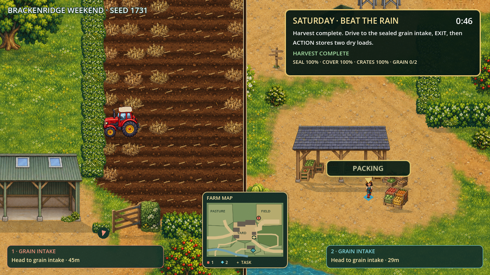

# Brackenridge Farm

An original illustrated 2D asymmetric couch-cooperative farming game for the Amazon Fire TV hackathon track. Two farmers share one screen and receive different facts on their phones: herd sheep, fix equipment, beat the rain and get the right goods to the buyer.



## For judges: run the browser build

Use the [candidate downloads](https://github.com/MilanRabrenovic/brackenridge-farm/releases) for the Web build, Fire OS debug APK, Vega wrapper and curated source. This repository contains source; it is not a hosted game service.

To run without installing Godot, download `brackenridge-farm-web.zip` into the repository root, then:

```sh
npm ci
unzip brackenridge-farm-web.zip
npm run dev
```

The Web archive extracts into `build/web/`. Open `http://127.0.0.1:8787/host/`, scan its QR from same-Wi-Fi phones, then press Enter on the laptop. Keep the laptop relay running. Admit both phones during arrival for co-op; one phone uses assisted solo testing. See [the playtest guide](docs/LAPTOP_PLAYTEST.md).

## Build locally

Requires Node 20+, Godot 4.7.2 and its Web export templates to rebuild. The prepared browser build is served by the relay:

```sh
npm install
npm run export:web
npm run dev
```

Open `http://127.0.0.1:8787/host/`. Use phones on the same Wi-Fi to scan the QR. Press Enter/Select on the host to admit them. Admit both during arrival for the cooperative weekend. With one phone you get the labelled full assisted solo weekend; press R after joining both to switch to the full cooperative session.

Drag to walk; ACTION beside the tractor enters it, EXIT returns to walking. Hold ACTION for shared work. Each phone's private card matters: speak to your partner or deliberately Share clue on TV. Drop returns cargo to its store. Pause freezes simulation; reconnect restores a phone slot. Results offer another seed through ready voting on both phones (one in solo), or the host button; R repeats the current seed. Farmer action cards, an adaptive minimap and offscreen pointers help with navigation while diagnosis and buyer clues stay private.

The farm uses layered terrain, collision walls/doorways, cutaway buildings, foreground occlusion, four-direction walking/tractor views and adaptive close split cameras. Barley can be prepared, planted, grown, harvested and damaged. Successful jobs progress immediately; failed deadlines lead forward with recovery stock.

## Verification and Fire TV

See [USEFUL_COMMANDS.md](USEFUL_COMMANDS.md) for all tests, export, visual review and installation commands. The Web export and signed Fire OS debug APK are built locally. Exporting creates `artifacts/countryside-coop-debug.apk`; candidate binaries are separate release downloads, not committed source files. Start the relay before launching on a Fire TV.

This is a complete scripted weekend candidate, **not yet verified as a hackathon submission**. The Vega simulator connected and the wrapper built/installed/launched, but Godot gameplay, TV remote input and qualifying recording remain unverified. Two-human full-run pacing and final visual acceptance remain open. Four players, Bedrock and hosted matchmaking are not implemented. See [docs/SUBMISSION.md](docs/SUBMISSION.md) for the prepared description, video plan and remaining requirements.

## Contributor entry point

Read `AGENTS.md`, then `PROJECT_STATE.md`, `GAME_DIRECTION.md`, `ART_DIRECTION.md`, `ASSET_CATALOG.md` and `USEFUL_COMMANDS.md` in order. Source art stays under `source_assets/`, optimized art under `game/assets/2d/`. Legacy 3D is retained as history and excluded from the active runtime. Code is MIT; see `LICENSE` and `THIRD_PARTY_NOTICES.md` for dependency/asset provenance.

A separate Vega WebView wrapper candidate and its setup are in [platform/vega/README.md](platform/vega/README.md). The local aarch64 package is `artifacts/brackenridge-farm-vega-aarch64.vpkg`; the release download is a separate candidate.
