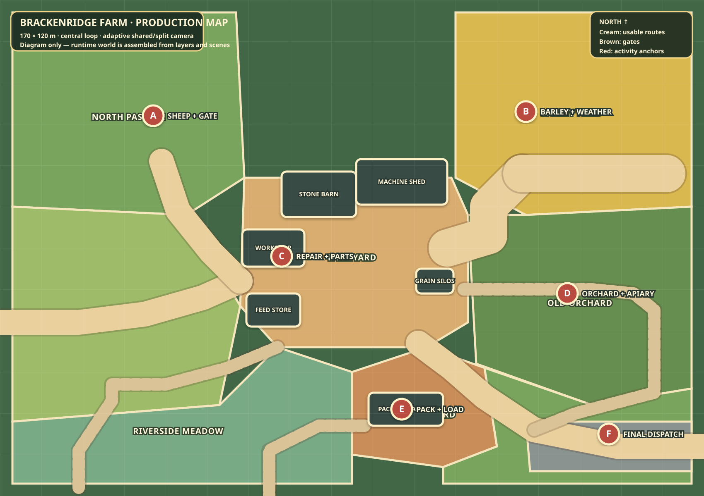

# 2D world production plan

Last updated: 2026-09-24

## Decision

Build one connected `170 × 120 metre` playable farm from reusable Godot scenes and layered textures. The existing farmyard illustration remains a visual reference and temporary proof. It is not the production map and will not be stretched into a larger background.

The production world uses the measured topology in `game/data/world_layout.json`. It is large enough for players to divide work and trigger the adaptive split camera, while every active district remains within a short walk or vehicle trip from the central yard.



The SVG is a planning diagram generated by `npm run map:plan`. It is not a runtime texture.

## What the farm contains

| District | Main function | Hackathon activities | Visible consequences |
|---|---|---|---|
| Central farmyard | Spawn, regrouping and shared resources | Tutorial, role assignment, vehicle selection | Equipment leaves/returns, deliveries accumulate, weather changes |
| North pasture | Livestock home area | Escaped sheep, guide-and-gate cooperation, feeding | Open/broken gates, flock location, damaged grass |
| Low meadow | Hay and overflow grazing | Move hay before rain, temporary sheep destination | Cut/uncut grass, wet hay, muddy passes |
| East barley field | Main arable activity | Rain Before Barley, tramline passes, harvest | Prepared/protected/damaged/harvested crop states |
| Workshop and machinery shed | Equipment hub | Diagnose-and-supply, tractor/combine access | Open bays, selected tool, repaired/broken machine |
| Grain lane and storage | Crop logistics | Trailer unloading, intake and silo storage | Trailer fill, intake activity, silo fill state |
| Orchard and apiary | Careful secondary work | Bee/weather risk and produce collection | Hive agitation, collected crates, blossom/fruit state |
| Packing yard | Market preparation | Sort, substitute, pack and stage orders | Correct/wrong crates, packed pallets, deadline state |
| Delivery lay-by | Session finish | Final dispatch and buyer requirement check | Van/truck arrival, loaded order, departure/result |
| Stream and crossings | Route choice | Reliable bridge versus weather-sensitive shortcut | High water, mud slowdown, blocked ford |

Sheep occupy one district and one incident family. They do not define the entire map.

## Travel and camera targets

- World art scale: `10 pixels per logical metre` (locked to the active collision and camera implementation).
- Complete authored footprint: `1700 × 1200 pixels` before decorative off-map scenery.
- Runtime districts use repeated terrain textures inside measured polygons; future authored transition chunks should target nominal `512 × 512 pixels`.
- Ordinary close camera: approximately `65 × 37 metres` at 1280 × 720 internal rendering.
- Shared view while players remain within `31 metres`.
- Split begins beyond `38 metres`; merge hysteresis remains.
- Central yard to any primary activity: roughly `6–14 seconds` on foot.
- Cross-farm route: roughly `20–28 seconds` on foot.
- Gates: six metres ordinary, ten metres for the combine.
- Heavy lane: nine metres, with a twelve-metre crop headland.

These targets keep travel meaningful without turning a 12–15-minute demo into walking time.

## Runtime layer stack

The world must be assembled in this order:

1. **Ground base** — grass, soil, yard gravel and stream bed, divided into chunks.
2. **Ground detail** — paths, ruts, verge blends, puddles, bridge surface and field headlands.
3. **Field state** — separate irregular polygons for soil preparation, seed rows, growing crop, mature crop, tramlines, harvested stubble and damage.
4. **Low fixed objects** — wall bases, hedge trunks, flower beds, bridge parapet bases and building foundations.
5. **Interactive objects** — gates, doors, tools, crates, machines, hives, hay and quest markers.
6. **Actors** — players, animals and vehicles inside one Y-sorted gameplay layer.
7. **Foreground occlusion** — roofs, tree crowns, tall hedge foliage, wall tops and bridge parapet fronts.
8. **Weather and consequences** — cloud shadow, rain, wetness, mud, dust and damage masks.
9. **Screen interface** — objectives, timer, private-fact indicators and split divider.

Only layers 1–3 may use broad chunk textures. Buildings, trees, gates, crops, props and all changing objects remain reusable scenes or state sprites.

## How objects allow characters to pass behind them

### Trees

Each tree is one reusable scene:

```text
TreeRoot (Y-sort position at trunk base)
├── GroundShadow       behind actors
├── Trunk              Y-sorted with actors
├── TrunkCollision     small collision around the trunk only
└── CanopyForeground   drawn above actors whose feet are north of the trunk base
```

The crown does not receive collision. A character can walk under the visible canopy but cannot pass through the trunk. If the crown hides a player for too long, it fades to about 55% opacity locally while that player overlaps its reveal area.

### Buildings

Each building scene separates foundation, walls, doorway, interior and roof:

```text
BuildingRoot (Y-sort origin along the south wall)
├── Foundation/BackWall
├── FootprintCollision with explicit doorway gaps
├── Door and interaction zones
├── Interior floor and storage states
└── RoofForeground
```

Outside, the roof naturally covers a character walking behind the building. Entering a usable doorway fades or hides the roof for that player's camera and reveals the interior. Decorative buildings without interiors use a closed footprint collision.

### Hedges, walls and gates

- Boundaries follow the irregular district polygons rather than a square tile grid.
- Their collision is split at every valid gate and foot gap.
- The low base and stems render below actors; foliage or capstones use the Y-sorted foreground layer.
- Every gate is a separate interactive scene with open, closed, held and damaged states.
- Vehicle clearance is tested using the tractor, trailer and combine envelopes from the layout data.

### Fields

- Each field is an irregular polygon with a reusable edge mask.
- Crop visuals are generated inside that polygon and clipped at the boundary.
- Headlands and tramlines are data, not painted decoration.
- Working a field changes its state layer and mask without replacing the whole map.
- Crops may overlap a character's lower legs for depth, but never cover the face or interaction marker.

## Collision and navigation rules

- Collision follows functional footprints, not the visible size of a roof or tree crown.
- Players use small foot circles; vehicle collision uses measured envelopes.
- Every operational district retains at least two exits.
- No decorative prop may reduce a heavy lane below nine metres or a combine gate below ten metres.
- Quest items never spawn inside occluders, crop density or closed collision.
- A failed or closed route always leaves one recovery path.
- The bridge remains reliable; weather may close or slow only the ford.
- Camera reveal areas prevent players, sheep or critical items from staying completely hidden.

## Quest geography

The map supports the complete hackathon weekend without adding another location:

1. **Arrival:** players learn movement and interaction in the central yard, then carry one item to packing.
2. **Animals versus weather:** sheep escape in the north pasture while barley or hay receives a private rain deadline.
3. **Breakdown versus delivery:** the failed machine sits at the shed, yard or field; diagnosis is private to one player while the order deadline belongs to another.
4. **Rain Before Barley:** one player holds the east combine gate while the other follows the paired tramlines.
5. **Market pressure:** produce travels from field/orchard through packing to the delivery lay-by, with private substitution rules.
6. **Final dispatch:** players combine storage condition and buyer requirements, choose the correct load and coordinate the last trip.

The same routes create variation through gate state, weather, machine location, order contents and available tools. New incidents do not require new districts.

## Production sequence

### Pass 1 — Functional map skeleton

- Convert every district, route, gate and structure in `world_layout.json` into 2D Godot nodes.
- Use flat review colours and final collision dimensions.
- Prove all walking, tractor, trailer, sheep and combine routes.
- Verify shared/split cameras and two-phone control across the complete footprint.

**Implementation state:** complete in code on 2026-09-24. Topology v4, measured actor/vehicle/building scale, yard-edge route terminals, district polygons, structures, world-edge collision and adaptive cameras are live and browser-inspected.

### Pass 2 — Terrain and boundaries

- Author reusable grass, soil, gravel, track, stream and field-edge chunks.
- Install hedges, drystone walls, fences, gates, bridge and ford.
- Add complete collisions and occlusion ordering.

**Implementation state:** composed review pass complete. The stream, bridge, ford, snapped horizontal/vertical hedge and wall modules, planted orchard, landmark trees, building footprints and Y-sorted/reveal layers are live. Eight authored terrain textures repeat at the corrected gameplay scale; heavy routes have paired wear, water has channel/reflection layers, and shared contact shadows ground the reusable art. Authored road junctions, endpoint-snapped boundary corners, transition blending and weather variants remain.

### Pass 3 — Buildings and interiors

- Install the barn, workshop, machinery shed, feed store, grain intake/silos and packing canopy as layered scenes.
- Add usable entrances only where an activity needs them.
- Implement roof reveal and storage-state visuals.

**Implementation state:** functional entrances and roof reveal are live for the barn, machinery shed, workshop and feed store. Grain fill/unload state is not implemented.

### Pass 4 — Activity-ready fields and props

- Add barley state masks, headlands and tramlines.
- Add pasture/sheep containment, hay states, orchard/apiary props, crates and delivery staging.
- Add vehicle parking, attachment and unloading anchors.

**Implementation state:** the barley field supports unprepared, prepared, seeded, seedling, young, mature, harvested and damaged visuals. Tractor coverage drives prepare/seed/harvest transitions and time drives growth. Other activity props remain.

### Pass 5 — Weather and polish

- Add cloud shadows, rain, wetness, mud and consequence overlays.
- Add decorative trees and flowers only after routes remain clear.
- Tune texture memory, overdraw and camera visibility for 30fps on Fire TV.

## Acceptance checks before quests are restored

- Two phones can walk from the yard to every activity without soft-locking.
- A player visibly passes behind and in front of each building, tree and tall boundary type.
- Every doorway, gate and heavy lane matches its collision.
- Tractor and combine routes have no decorative blockage.
- Split camera remains readable at opposite map corners.
- Crop states can change independently from terrain and boundaries.
- One building roof can reveal an interior without changing the rest of the map.
- The browser build sustains the current input response and the Fire TV target remains 30fps.

Only after these checks should the incident UI and authored weekend be attached to the new map.

## Placement correction — 2026-09-28

Layout v5 now defines structures, props, trees and boundary runs in the same file as roads and destinations. `test:map` checks 468 route samples against real collision using the relevant vehicle width, then floods walkable space from the yard to all ten destinations. All pass. The crop lane is excluded from planting/work, the orchard has a southern exit, and bridge/ford approaches connect to the estate. Seven fresh native views are recorded in `docs/audits/2026-09-28-placement/`. Art seams, gate animation and water treatment remain unresolved; this is not final production approval.
