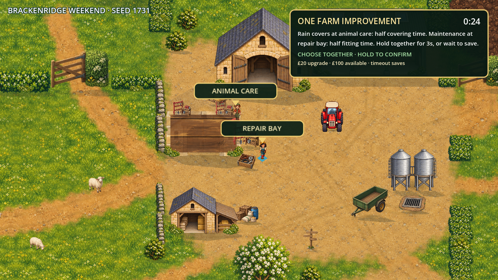
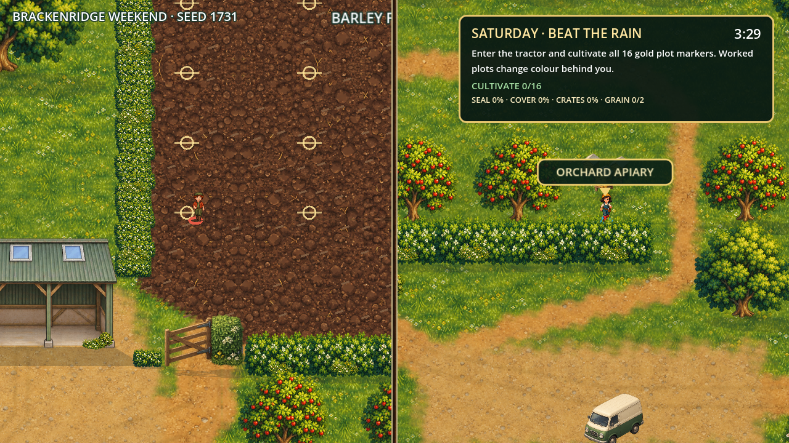
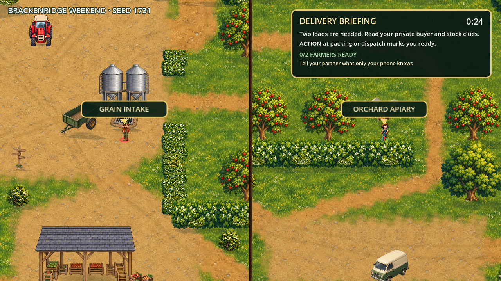
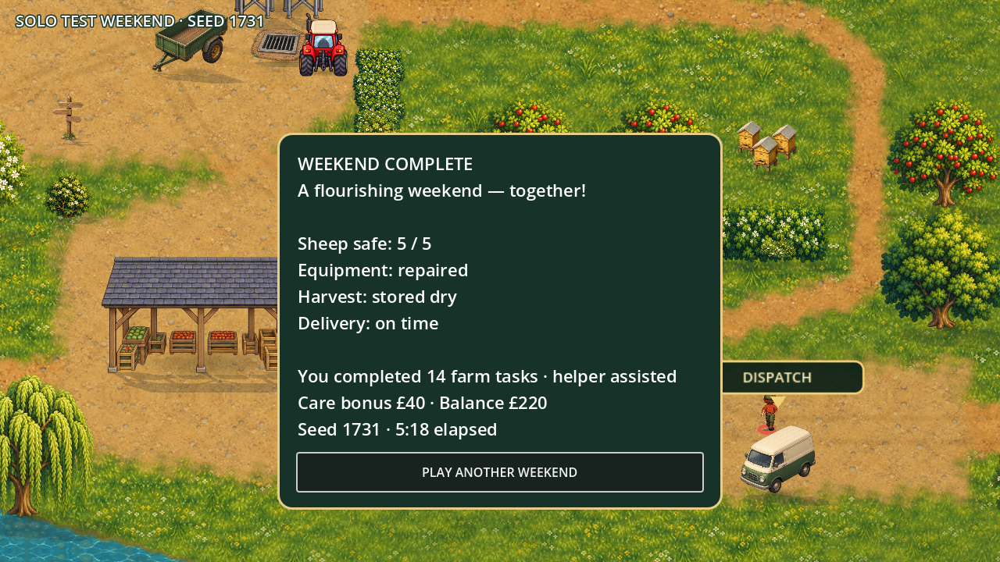

# Mission experience review — September 30, 2026

## Current verdict

The weekend now has clearer actions, meaningful upgrade confirmation, readable mission results and more useful partner jobs. The previously confirmed design defects were addressed and the full assisted solo input route completes successfully. **Human enjoyment and first-time clarity are not yet verified.** This is an implementation review supported by automated behavior checks and rendered screens.

## Implemented improvements

| Audited problem | Current behavior |
|---|---|
| Arrival lacked stakes/acknowledgement | Shared weekend goal and explicit hay-check acknowledgement |
| Gate keeper had to stand still | ACTION opens an eight-second window; keeper can help herd and refresh it |
| Instant/duplicate purchases | Three continuous seconds of confirmation, release resets, affordability and ownership guards |
| Late upgrades had no remaining benefit | Second planning phase replaced by delivery briefing; no spending |
| Mission results disappeared immediately | Three-second success/failure beat before the following job |
| Hidden field triggers/automatic handoff | 16 authored gold plot targets, local worked patches, explicit tool engagement before sowing/harvesting |
| Storage partner had little to do | Seal intake, cover apples, optional prepare packing crates; visible progress |
| Growth meant only waiting | Driver can exit and help storage/protection during growth |
| Cargo messages erased private facts | Persistent mission fact plus separate current-action hint; reconnect restores both |
| Dispatch feedback was misleading | Buyer preference retained privately; packing and van prompts reflect current cargo progress |
| Failure changed only recap | Failed repair lengthens loading; crates reduce loading time; successful care jobs earn bonuses |
| Repeat commands inflated recognition | Unique task credits; solo helper participation identified; perfect heading requires all four outcomes |

No additional incident family, art asset or map layout change was introduced. Field progress remains an abstraction: local patches are visible, but the overall crop stage changes after all 16 plots. The gate change provides participation opportunities; it does not prove balanced workload.

## Verification

- Full native solo input-handler/physics route passed, including all natural crop stages, storage sealing, correct dispatch, results and replay. Results at 5:18 simulated time; 266.9 seconds of accelerated input simulation plus two explicit planning waits. This is not normal human duration.
- Three cooperative scripted routes, failure recovery, private seeded faults and 1000 stable seed choices passed. Some test actors are positioned directly; this is not a two-human playthrough.
- Focused `test:missions` passed purchase timing/reset/ownership, no late purchases, persistent facts, command/task-credit guards, deliberate tool operation, seal/cover/crates and gate-window expiration.
- Existing 2D host and repair checks passed; nine Node tests and TypeScript passed. The small pre-existing 2D-host exit leak warning remains.
- Eight staged 1280×720 cooperative screens were inspected. Their zero-time/result values are fixtures. Actual solo results were separately inspected.
- Browser tractor controls inspected at 390×780: readable dashboard/tool button and reachable steering/EXIT. Brief local frame acknowledgement was 19–24 ms median; not full-route network/performance evidence.
- Web export/exported-PCK startup and signed Fire OS APK packaging passed. Physical TV gameplay remains untested.

## Current screen evidence

Historical baseline findings are preserved in `history/2026-09-30/MISSION_EXPERIENCE_AUDIT.md`; their original screenshots were replaced by current captures.

## Remaining acceptance risks

1. The mechanic now has a pump/release pressure activity during fetching and fitting, and inspection reveals the diagnosis. This addresses the formerly mandatory idle/continuous-hold role. Balanced participation and whether pressure feels enjoyable still need two-person observation.
2. Destination world labels can leave split-screen view. The new adaptive minimap provides farm orientation and public task locations; there are still no per-player offscreen arrows or collision-aware routes. Shared objective placement may compete with play space.
3. Field-wide stage changes, accelerated growth and few work animations remain visibly simplified. Sheep now have shader leg-pair motion and a bounded fence-jump opening, but no dedicated directional gait sheet. No dedicated repair/boarding/carry animation was added.
4. Phone fact/hint length varies by phase; portrait tractor controls were inspected, but every text variant and real mobile browser is not exhaustively verified.
5. Timed missions, reading speed, child comprehension and sustained holds need human validation. No attention-retention, accessibility-compliance or entertainment claim is made.

## Single next task

Observe a first-time normal-speed solo run for instruction/navigation clarity, then a two-person run for communication and idle time. Record objective-understanding time, wrong turns, help requests, idle intervals, failed tasks and whether players want to replay. Avoid explaining objectives unless they become stuck, and record any intervention. Use those findings for pacing changes rather than increasing scope.

## Sheep personality follow-up

Implemented and inspected a seeded staggered fence breakout, evasive jinks when approached too fast, independently moving leg pairs from existing art and jump/ground-shadow separation. Full automated solo route and three co-op routes pass, plus the focused sheep motion/capture check. Safely returned sheep remain safe; this opening comedy does not add recurring punishment or a new incident type. Human co-op entertainment has not been established.

## Co-op repair participation follow-up

Added active pump/release pressure regulation and inspect-to-discover diagnosis. Runner fitting requires both players nearby and pressure in the green band; holding continuously overheats and pauses progress. Progress is retained, maintenance shortens fitting, and solo helper balances the gauge. Repair tests verify these behaviors and preservation of the original private diagnosis during status changes. Three full scripted cooperative routes and the solo input route pass. Native low/green/hot staged UI states were inspected. This is expert/automated evidence, not human fun validation; the actual machine and work poses remain static artwork.

## Minimap navigation follow-up

Layout-derived minimap added for shared/split play, showing both farmers and public job destinations without private order information. Native shared/split/merged captures inspected; focus tests cover placement, visibility and target privacy. Human wayfinding and actual TV readability remain unverified.

## October 5 cooperative route follow-up

A complete two-slot packet/motor route now passes all four successful outcomes and replay for seeds 1731–1733, without solo assistance, actor teleporting or crop-stage assignment. It exposed accidental tractor boarding when ACTION was pressed during a result message; context actions now ignore those transitions. Actual native repair, split harvest and results frames were inspected. The route verifies physical access and required joint inputs; it cannot verify whether first-time players discover the solution, communicate effectively, enjoy it or remain engaged. Human co-op acceptance is still required.

## October 15 laptop follow-up

Added per-player current action/destination cards and offscreen compass cues around the minimap. They preserve private diagnosis/order facts; nearest supply is a public landmark, not an answer. Phone results/replay removes the need to reach the laptop between rounds; joint consent/cancellation/disconnect guards and solo replay are tested. The current room is visible on phones. Expanded results initially clipped, then passed centring/bounds recapture. Native co-op route again completed all four jobs/results/replay; updated actual route frames are in `audits/2026-10-15-finish/`.

Per the user's October 15 instruction, complete laptop checks first and defer human/TV acceptance to the final step. The new UI addresses navigation/replay friction; it does not establish first-time understanding or fun. Existing four events remain the scope; no new incident family was added.
